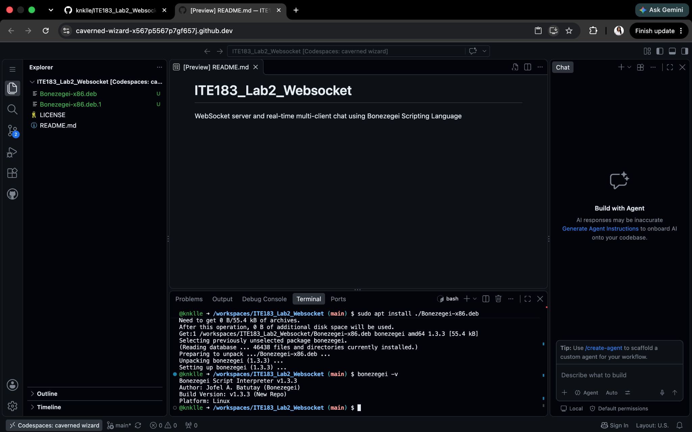
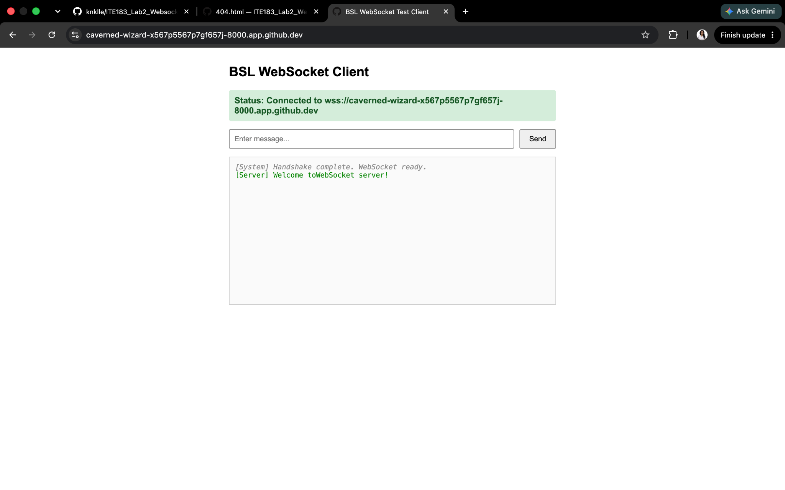
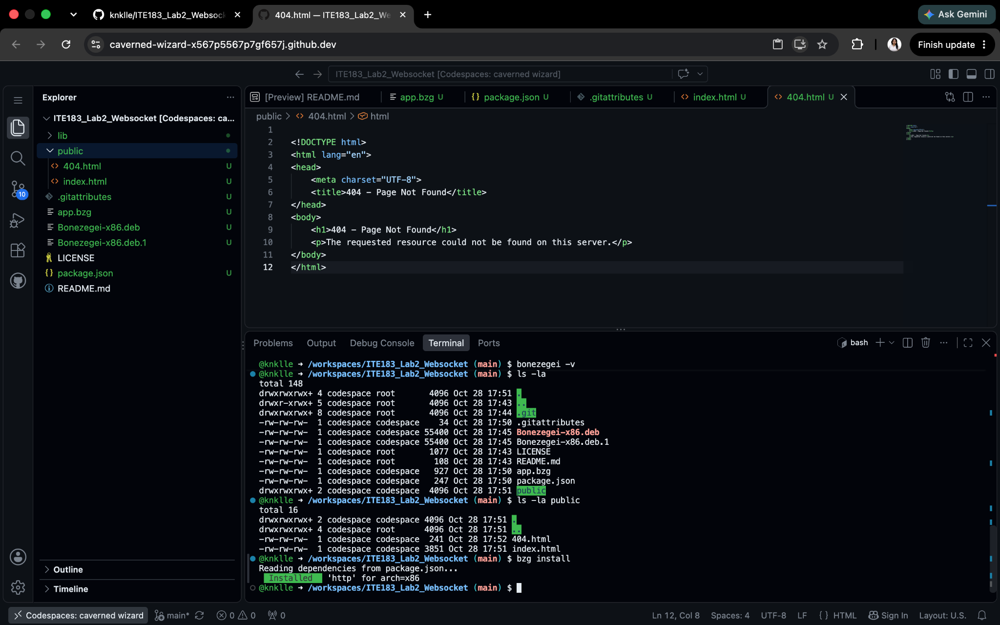
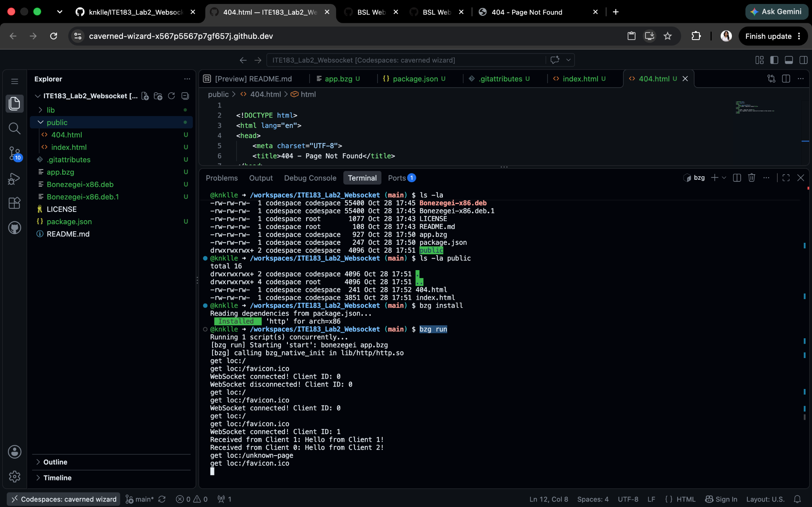
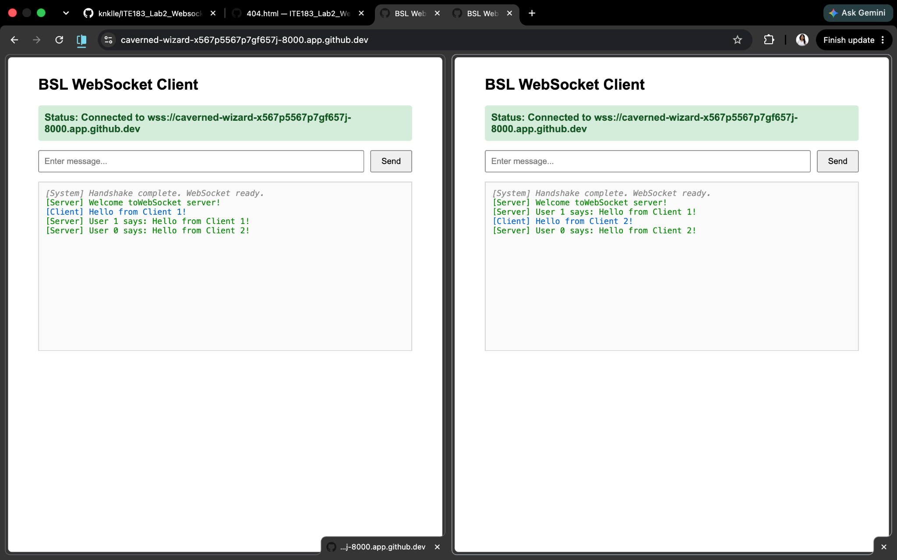
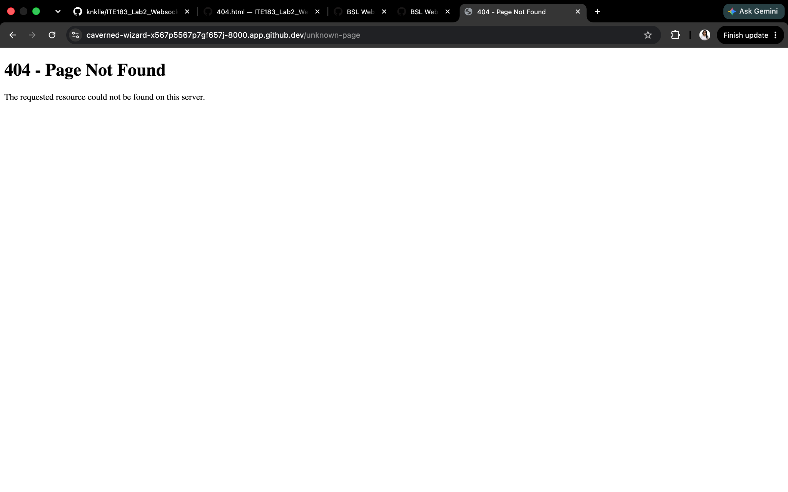
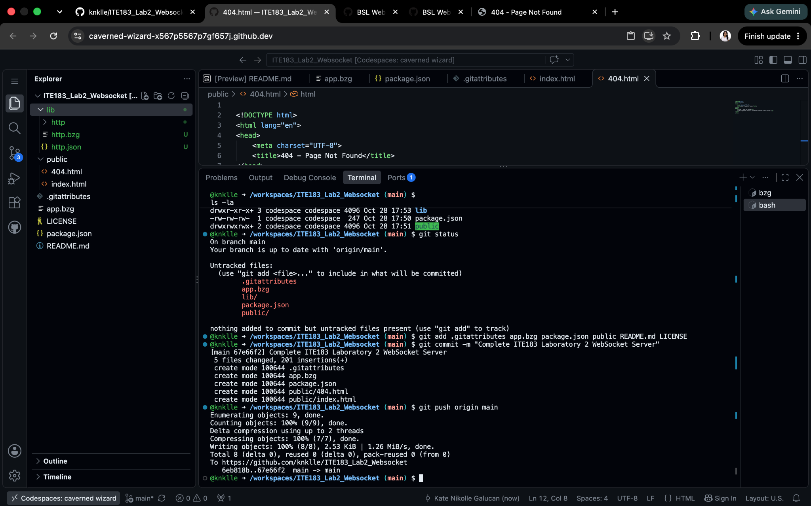

# ITE183 Laboratory 2: WebSocket Server

A real-time, multi-client WebSocket chat application developed for **ITE183 – Web Systems and Technologies, Laboratory 2** using **Bonezegei Scripting Language v1.3.3** and GitHub Codespaces.

## Laboratory objectives

This activity demonstrates:

1. Creating and running an event-driven WebSocket server for full-duplex communication.
2. Handling WebSocket client connections, unique client IDs, incoming messages, and disconnections.
3. Broadcasting messages in real time to multiple connected browser clients.

## Development environment

- **Environment:** GitHub Codespaces (Linux)
- **Language/runtime:** Bonezegei Scripting Language v1.3.3
- **Dependency:** Bonezegei `http` package, declared in `package.json`
- **Server port:** `8000`
- **Frontend:** HTML, CSS, and JavaScript
- **Version control:** Git and GitHub

### 1. Runtime verification

Bonezegei v1.3.3 was installed using the Linux `.deb` package and verified with:

```bash
bonezegei -v
```



*Figure 1. Codespaces terminal showing the successful installation and Bonezegei v1.3.3 version check.*

## Project structure

```text
ITE183_Lab2_Websocket/
├── .gitattributes         # GitHub syntax highlighting for .bzg files
├── .gitignore             # Excludes locally installed dependencies (if configured)
├── app.bzg                # HTTP and WebSocket server
├── package.json           # Project metadata and http dependency
├── public/
│   ├── index.html         # Browser-based chat interface
│   └── 404.html           # Custom page for undefined routes
├── screenshots/           # Evidence from testing
├── README.md              # Project documentation
└── LICENSE                # MIT License
```

The `lib/` folder may be generated locally by `bzg install`. It is not required to be committed if dependencies are installed again when setting up the project.

## Implementation

### 2. HTTP and WebSocket server (`app.bzg`)

The server listens on **port 8000** and handles both ordinary HTTP requests and WebSocket events:

| Function / event | Purpose |
| --- | --- |
| `server.get` | Serves `public/index.html` for `/` and `public/404.html` for other paths |
| `server.onConnect` | Logs a client ID and sends a welcome message |
| `server.onData` | Receives messages and broadcasts them with `server.sendAll()` |
| `server.onDisconnect` | Logs disconnected client IDs |
| `server.run()` | Starts the server |

### 3. Browser client (`public/index.html`)

The frontend provides a connection status, message input, Send button, and a log of sent and received messages. Because the activity was run in **GitHub Codespaces**, the client selects the forwarded hostname and the `wss://` protocol when the page uses HTTPS, instead of the PDF's local-only `ws://localhost:8000` setting.



*Figure 2. Browser client successfully connected through the Codespaces forwarded port and receiving the server welcome message.*

## Installation and execution

From the repository root, verify that Bonezegei **v1.3.3** is installed, then run:

```bash
bzg install
bzg run
```

The first command installs the dependencies declared in `package.json`; the second starts the application. In GitHub Codespaces, forward **port 8000** from the **Ports** tab and open its forwarded HTTPS URL in a browser.



*Figure 3. Successful `bzg install`, showing the HTTP dependency installed.*



*Figure 4. `bzg run` starting the server, followed by HTTP requests, WebSocket connections, and incoming messages.*

## Functional testing and results

### 4. Multi-client message broadcasting — PASS

Two browser clients were opened using the same forwarded Codespaces URL. A message was sent from each client:

- Client 1 sent: `Hello from Client 1!`
- Client 2 sent: `Hello from Client 2!`

**Observed result:** Both clients displayed both broadcast messages. The server log recorded the received messages along with their client IDs. This confirms the use of `server.sendAll()` for real-time multi-client broadcasting.



*Figure 5. Both browser windows receive the same messages sent by Client 1 and Client 2.*

### 5. Custom 404 page — PASS

To verify HTTP route handling, the `/unknown-page` route was opened in the browser.

**Observed result:** The application displayed the custom **404 - Page Not Found** HTML page from `public/404.html`. This test verifies the page content for an undefined route; it does not independently confirm the HTTP response status code.



*Figure 6. Custom page displayed after visiting `/unknown-page`.*

### 6. Connection lifecycle and server logs — PASS

The terminal recorded client connection events, message reception, and a client disconnection event. The log also displayed HTTP requests such as `/` and `/unknown-page`.


*Figure 7. Terminal evidence for connection handling, messages, and HTTP requests.*

## GitHub repository submission

The project source was committed and pushed to the public repository:

**Repository:** https://github.com/knklle/ITE183_Lab2_Websocket



*Figure 8. Successful Git commit and push to the `main` branch.*

## Conclusion

In this laboratory activity, I set up Bonezegei v1.3.3 in GitHub Codespaces and created a WebSocket server with a browser-based chat interface. The tests showed that two connected clients could send and receive broadcasts in real time. I also verified that the application displayed the custom page for an unknown route and that the server logged connection and message events. These results demonstrate full-duplex communication, event-driven socket handling, and basic HTTP route handling in Bonezegei.

## License

This project is distributed under the **MIT License**. See [LICENSE](LICENSE).
